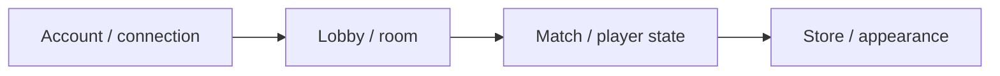

# DumbGuys — Multiplayer Obstacle Game

[English](README.md) · [Korean](README.ko.md) · [Japanese](README.ja.md)

**C++ · C# · Unity** · 開発記録

[開発事例を見る](https://ysl-ryudo.github.io/ja/work/dumbguys/) · [Portfolio](https://ysl-ryudo.github.io/ja/)

独立したC++サーバーと連携するUnityマルチプレイヤー障害物ゲームです。

## 取り組んだ課題

アカウント、ルーム、プレイヤー外見をロビーと試合の流れにつなぐ実装です。クライアントとサーバーの互換性がある版を選ぶことも重要です。

## 担当した実装と設計

アカウント・接続処理、ルーム・プレイヤー状態、ショップ・外見データ、クライアントのロビー・試合連携を担当しました。

### 実装概要 · 概念フロー

### 開発デモ動画

- [DumbGuys full play](https://www.youtube.com/watch?v=Z4tffAvRjJs)

撮影時点のプロジェクトデモです。ゲーム内での担当作業は以下の担当範囲で示します。

## 担当した内容

- クライアント通信とログイン・ロビー・ロード・試合・結果のフローを担当しました。
- 移動・入力の分離と、移動床、押し合い、落下、曲線パイプ移動などの操作を実装しました。
- restore-1121で統合・サウンドの作業を継続しました。デフォルトブランチにない後続の変更が含まれます。

## 貢献の根拠

- [Development branch / 작업 브랜치 / 作業ブランチ](https://github.com/YSL-RyuDo/DumbGuys/tree/restore-1121)
- [Pipe transport / 파이프 이동 / パイプ移動](https://github.com/YSL-RyuDo/DumbGuys/commit/359f27621811e1cdc667328cfb55d799340cb3e6)
- [Later snapshot / 후속 버전 / 後続版](https://github.com/YSL-RyuDo/DumbGuys/commit/6c30b670a68da9a89d8ad0445de376cd620a21a7)

コミットは記載した変更の根拠であり、貢献率の点数ではありません。外部素材・チームメンバーの貢献は区別します。

## 実行・コードの確認

[ProjectVersion.txt](ProjectSettings/ProjectVersion.txt)記載のUnity版で開いてください。パッケージロックとシリアライズ済み素材を維持し、Unityを開く前に対象ブランチを選んでください。

- Unity scene: [Assets/Scenes/LoginScene.unity](Assets/Scenes/LoginScene.unity)

[DumbGuysServer](https://github.com/YSL-RyuDo/DumbGuysServer)

## 開発・検証範囲

後続のクライアント実装はmainから分岐したrestore-1121を参照してください。「完成」というコミット名を現行の通しプレイ検証と同一視しません。素材・依存関係の元のクレジットを維持します。

## 実装の確認方法

デモ前にサーバーの基準版とクライアントの後続restore-1121ブランチを比較してください。記録は実装範囲を示すもので、新しい性能測定ではありません。
