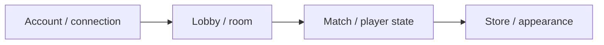

# DumbGuys — Multiplayer Obstacle Game

[English](README.md) · [Korean](README.ko.md) · [Japanese](README.ja.md)

**C++ · C# · Unity** · 개발 기록

[개발 사례 보기](https://ysl-ryudo.github.io/ko/work/dumbguys/) · [Portfolio](https://ysl-ryudo.github.io/ko/)

별도의 C++ 서버와 연결되는 Unity 멀티플레이 장애물 게임 프로젝트입니다.

## 해결하려던 문제

계정·방·플레이어 외형 정보를 로비와 경기 흐름으로 연결하는 작업입니다. 클라이언트와 서버를 서로 맞는 버전에서 살펴보는 것도 중요합니다.

## 내 구현과 설계

계정·연결 처리, 방·플레이어 상태, 상점·외형 데이터와 클라이언트 로비·경기 연동을 작업했습니다.

### 구현 개요 · 개념 흐름도

### 개발 시연 영상

- [DumbGuys full play](https://www.youtube.com/watch?v=Z4tffAvRjJs)

촬영 당시의 프로젝트 시연입니다. 게임 안에서 제가 맡은 작업은 아래 기여 항목으로 구분합니다.

## 내 기여

- 클라이언트 네트워크와 로그인·로비·로딩·경기·결과 흐름을 작업했습니다.
- 이동·입력 분리와 이동 발판, 밀기, 낙하, 곡선 파이프 이동 등의 상호작용을 구현했습니다.
- restore-1121에서 통합·사운드 후속 작업을 이어갔습니다. 기본 브랜치에 없는 후속 작업이 이 브랜치에 있습니다.

## 기여 근거

- [Development branch / 작업 브랜치 / 作業ブランチ](https://github.com/YSL-RyuDo/DumbGuys/tree/restore-1121)
- [Pipe transport / 파이프 이동 / パイプ移動](https://github.com/YSL-RyuDo/DumbGuys/commit/359f27621811e1cdc667328cfb55d799340cb3e6)
- [Later snapshot / 후속 버전 / 後続版](https://github.com/YSL-RyuDo/DumbGuys/commit/6c30b670a68da9a89d8ad0445de376cd620a21a7)

커밋은 설명한 변경의 근거이며 기여율 점수가 아닙니다. 외부 에셋과 팀원 작업의 크레딧은 구분합니다.

## 실행·코드 확인

[ProjectVersion.txt](ProjectSettings/ProjectVersion.txt)의 Unity 버전으로 프로젝트를 여세요. 패키지 잠금 파일과 직렬화된 에셋을 유지하고, Unity를 열기 전에 문서에서 설명한 브랜치를 선택하세요.

- Unity scene: [Assets/Scenes/LoginScene.unity](Assets/Scenes/LoginScene.unity)

[DumbGuysServer](https://github.com/YSL-RyuDo/DumbGuysServer)

## 개발·검증 범위

후속 클라이언트 구현은 main과 갈라진 restore-1121을 기준으로 살펴보세요. '완성'이라는 커밋 메시지를 현재 전체 플레이 검증으로 대체하지 않습니다. 에셋·의존성의 원래 크레딧을 유지합니다.

## 구현을 확인하는 방법

시연 전 서버 기준 버전과 클라이언트의 후속 restore-1121 브랜치를 비교해야 합니다. 개발 기록은 구현 범위를 설명하며 새로 측정한 성능 결과는 아닙니다.
