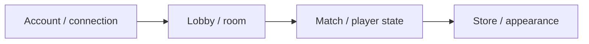

# DumbGuys — Multiplayer Obstacle Game

[English](README.md) · [Korean](README.ko.md) · [Japanese](README.ja.md)

**C++ · C# · Unity** · Development archive

[Explore the case](https://ysl-ryudo.github.io/en/work/dumbguys/) · [Portfolio](https://ysl-ryudo.github.io/en/)

A Unity multiplayer obstacle-game project with a separate C++ server.

## The engineering problem

Accounts, rooms and player appearance need to carry through the lobby and match flow. A client and server must also be reviewed at compatible revisions.

## My implementation

I worked on account/connection handling, room and player state, store/appearance data and client-side lobby/match integration.

### Implementation overview · conceptual flow

### Development videos

- [DumbGuys full play](https://www.youtube.com/watch?v=Z4tffAvRjJs)

Recorded project demonstrations; the contribution section below identifies my work within the game.

## My contribution

- Worked on client networking and the login, lobby, loading, game and result flows.
- Implemented movement/input separation and gameplay interactions such as moving platforms, pushing, falling and curved pipe transport.
- Continued integration and sound work on restore-1121; this branch carries later work not represented by the default-branch snapshot.

## Contribution evidence

- [Development branch / 작업 브랜치 / 作業ブランチ](https://github.com/YSL-RyuDo/DumbGuys/tree/restore-1121)
- [Pipe transport / 파이프 이동 / パイプ移動](https://github.com/YSL-RyuDo/DumbGuys/commit/359f27621811e1cdc667328cfb55d799340cb3e6)
- [Later snapshot / 후속 버전 / 後続版](https://github.com/YSL-RyuDo/DumbGuys/commit/6c30b670a68da9a89d8ad0445de376cd620a21a7)

Commits are evidence of the stated changes, not a percentage-of-authorship score. Third-party assets and teammates' work remain separately credited.

## Open and inspect

Open the project with the Unity version recorded in [ProjectVersion.txt](ProjectSettings/ProjectVersion.txt). Keep its package lock and serialized assets intact. Select the documented branch before opening Unity.

- Unity scene: [Assets/Scenes/LoginScene.unity](Assets/Scenes/LoginScene.unity)

[DumbGuysServer](https://github.com/YSL-RyuDo/DumbGuysServer)

## Development and verification scope

Use restore-1121 when inspecting the later client implementation; it has diverged from main. A commit message saying 'complete' is not a substitute for a current end-to-end playtest. Assets and dependencies retain their original credits.

## How to evaluate the work

Compare the server baseline with the client's later restore-1121 branch before a demo. The archive documents implementation scope, not a newly measured performance result.
